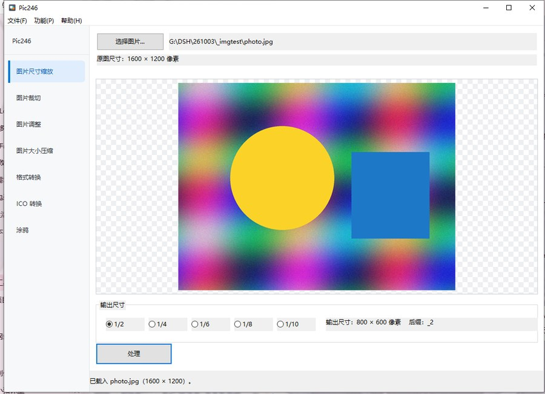
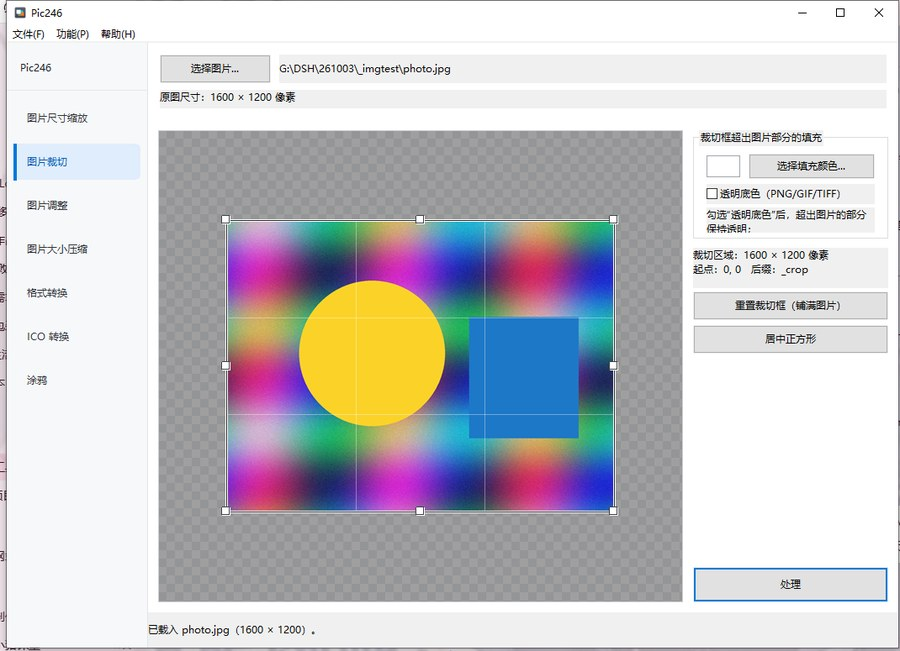
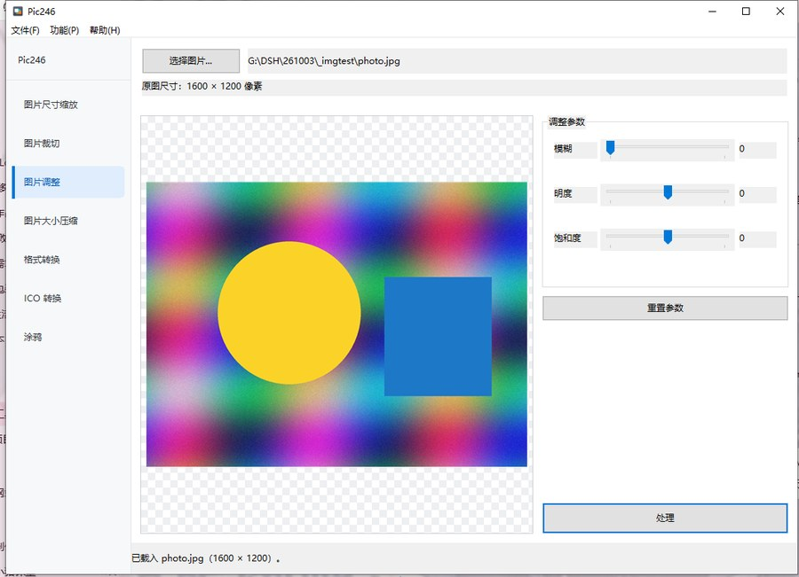
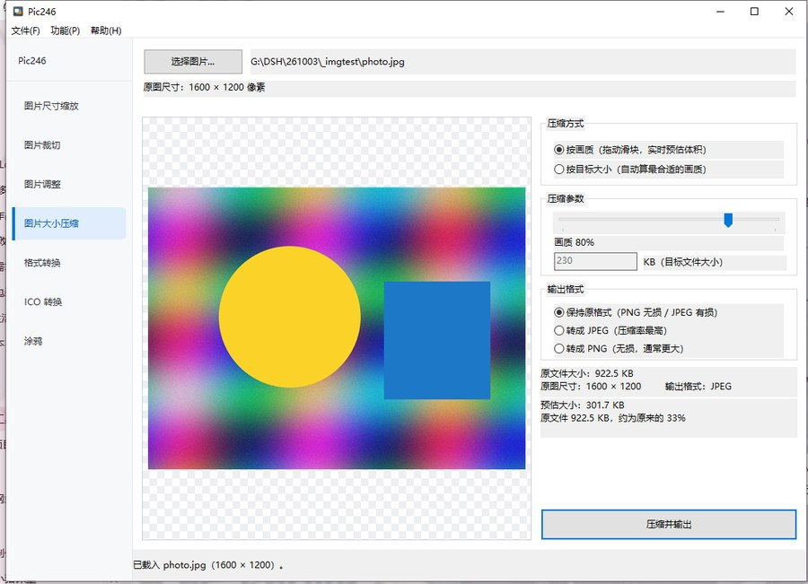
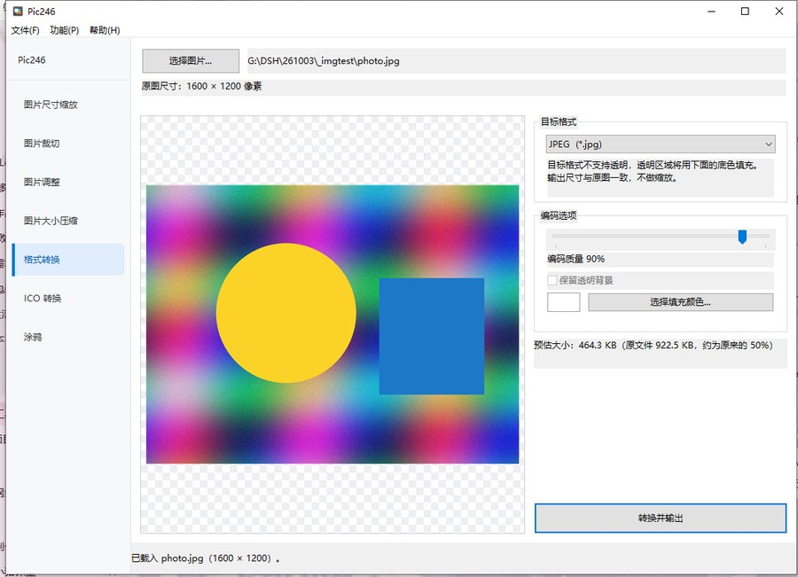
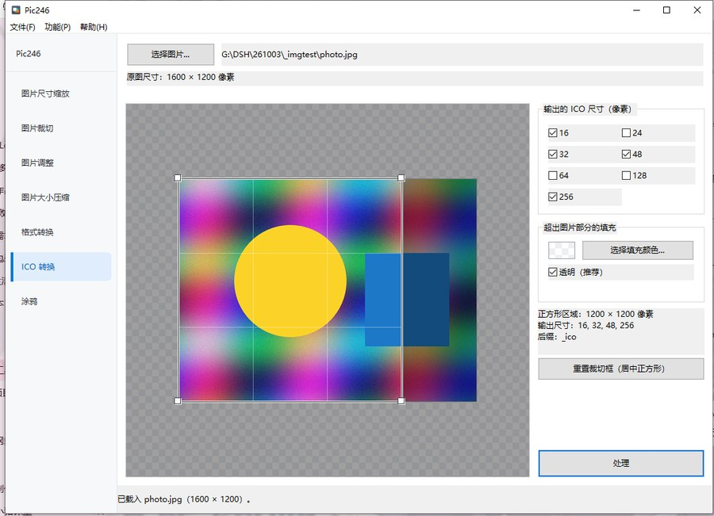
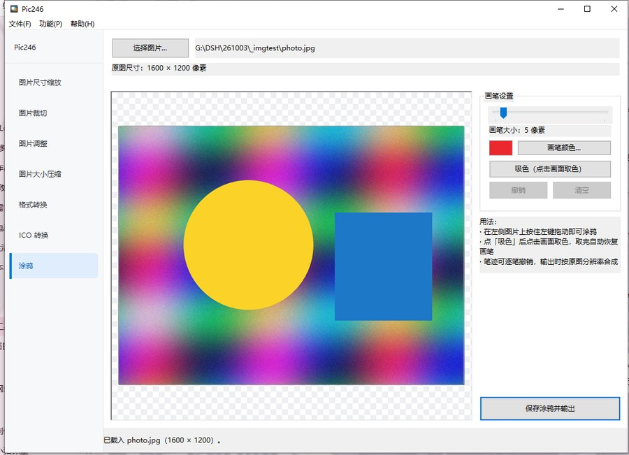
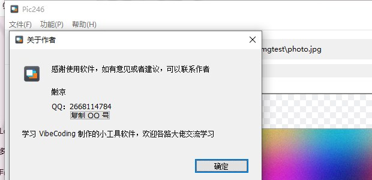

# Pic246 —— 轻量图片处理小工具

一个用 **C++ / Win32 API + GDI+** 纯手工写的 Windows 桌面小工具：**绿色免安装**，单个 exe 双击即用，不依赖任何第三方库，也不需要装 VC++ 运行库。



---

## 目录

- [它能做什么](#它能做什么)
- [功能详解](#功能详解)
- [使用方法](#使用方法)
- [输出文件命名规则](#输出文件命名规则)
- [支持的图片格式](#支持的图片格式)
- [系统要求](#系统要求)
- [如何编译](#如何编译)
- [如何打包成单文件 exe](#如何打包成单文件-exe)
- [项目结构](#项目结构)
- [常见问题](#常见问题)
- [关于作者](#关于作者)

---

## 它能做什么

Pic246 把「日常处理图片」最常用的几件事集中在一个小窗口里，左侧边栏切换功能：

| # | 功能 | 一句话说明 | 输出后缀 |
|---|------|-----------|---------|
| 1 | **图片尺寸缩放** | 把图片按 1/2、1/4、1/6、1/8、1/10 缩小 | `_2` `_4` `_6` `_8` `_10` |
| 2 | **图片裁切** | 在图上拖一个裁切框，框外的部分用填充色或透明补上 | `_crop` |
| 3 | **图片调整** | 模糊、明度、饱和度调整，**实时预览** | `_adjust` |
| 4 | **图片大小压缩** | 压体积不压尺寸：按画质调，或直接指定目标 KB | `_min` |
| 5 | **格式转换** | 在 PNG / JPEG / BMP / GIF / TIFF / WebP 之间互转 | `_png` `_jpg` … |
| 6 | **ICO 转换** | 生成含多个尺寸的 .ico 图标文件 | `_ico.ico` |
| 7 | **涂鸦** | 在图上画笔画、吸色取色、逐笔撤销、一键清空 | `_draw` |

所有处理结果都**保存在原图所在目录**，文件名 = 原文件名 + 后缀，**永远不会覆盖原图**（如果同名文件已存在，会先问你一句）。

---

## 功能详解

### 1. 图片尺寸缩放


- 五个倍率单选框：`1/2` `1/4` `1/6` `1/8` `1/10`，选中后立刻显示输出尺寸
- 缩放算法是 **高质量双三次插值（HighQualityBicubic）**，边缘用 `WrapModeTileFlipXY` 处理，避免出现黑边
- 结果文件名例如 `photo_2.png`

### 2. 图片裁切



- 裁切框可以直接**拖拽移动**，四边四角八个控制点可以**拉伸**
- 裁切框**可以拖到图片外面**——超出图片的部分由你决定怎么补：
  - 选一个**填充颜色**（默认白色），点「选择填充颜色...」可以调色
  - 或者勾选**透明底色**（输出格式支持透明时才有效，比如 PNG/GIF/TIFF）
- 「重置裁切框（铺满图片）」「居中正方形」两个按钮可以一键摆正
- 右下角实时显示裁切区域尺寸、起点坐标和后缀

### 3. 图片调整



三个滑块，**拖动过程中实时预览**（在缩略图上算，所以大图也不卡）：

| 参数 | 范围 | 说明 |
|------|------|------|
| 模糊 | 0 ~ 40 | 0 = 不模糊，数字越大越糊 |
| 明度 | -100 ~ 100 | 负数变暗，正数变亮 |
| 饱和度 | -100 ~ 100 | -100 = 接近黑白，正数更鲜艳 |

点「重置参数」恢复成 0/0/0（即原图）。

### 4. 图片大小压缩



**这是压缩文件体积，不是压缩图片尺寸** —— 输出图片的宽高和原图完全一样。

两种模式：

- **按画质**：拖滑块（10 ~ 100），界面右上角**实时预估**输出体积和压缩比
- **按目标大小**：直接填想要的 KB 数，程序用**二分法**自动算出"不超过该体积的最高画质"

还能顺手把输出格式指定为「保持原格式 / 转成 JPEG / 转成 PNG」。

> 预估为什么准？因为预估和实际保存用的是**同一份 32 位位图数据、同一个编码器、同一个质量参数**，所以界面显示的数字和最终文件体积基本一致。

### 5. 格式转换



- 下拉框列出**你系统上 GDI+ 实际安装的编码器**（一般是 PNG / JPEG / BMP / GIF / TIFF / WebP）
- 有损格式（JPEG / WebP）才会显示"编码质量"滑块
- 支持透明的格式会显示「保留透明背景」；不支持的格式会自动用**填充色**垫底，避免透明区变成黑块
- 不含格式转换，输出尺寸和原图一致

### 6. ICO 转换



- 勾选要包含的尺寸：`16` `24` `32` `48` `64` `128` `256`（默认勾 16/32/48/256）
- 256×256 那一帧按 **PNG 压缩**存进 ico（标准做法，体积小、兼容性好）；其余尺寸用 32 位 DIB
- 裁切框是**正方形**的，拖出图片的部分同样可以选填充色或透明
- 一个 .ico 文件里可以同时装多个尺寸，Windows 会按显示位置自动挑合适的那个

### 7. 涂鸦



- **画笔**：粗细 1 ~ 60 可调，颜色可自选
- **吸色**：点一下画面，把那个像素的颜色吸过来当画笔色（吸完自动退出吸色模式）
- **撤销**：逐笔撤销（不是逐像素）
- **清空**：一键清掉所有笔迹
- 输出时按**原图分辨率**重新绘制笔迹并合成，所以不会因为放大缩小而糊掉

### 附加：关于作者



菜单 **帮助(H) → 关于作者(&A)...** 打开，里面有「复制 QQ 号」按钮，点一下就能把联系方式复制到剪贴板。

---

## 使用方法

1. **打开图片**（三种方式任选）：
   - 点左上角「选择图片...」
   - 把图片文件**直接拖进窗口**
   - 把图片路径当命令行参数传给 exe
2. **在左侧边栏选择功能**
3. **调好参数**（大部分页面都有实时预览或尺寸/体积提示）
4. 点页面里的「处理」/「转换并输出」/「保存涂鸦并输出」按钮
5. 处理完成后会弹一个提示框，问你要不要**打开输出文件所在的文件夹**

**快捷键**：

| 快捷键 | 作用 |
|--------|------|
| `Ctrl + O` | 打开图片 |
| `Ctrl + S` | 处理并输出（等价于点当前页的处理按钮） |
| `Tab` | 在控件之间切换焦点 |

---

## 输出文件命名规则

**所有输出都放在原图所在目录，文件名 = 原文件名 + 后缀 + 原扩展名**（ICO 固定为 `.ico`）。

假设原图是 `D:\照片\风景.png`：

| 功能 | 输出文件 |
|------|---------|
| 缩放到 1/2 | `D:\照片\风景_2.png` |
| 缩放到 1/4 | `D:\照片\风景_4.png` |
| 缩放到 1/10 | `D:\照片\风景_10.png` |
| 裁切 | `D:\照片\风景_crop.png` |
| 调整 | `D:\照片\风景_adjust.png` |
| 大小压缩 | `D:\照片\风景_min.png`（保持原格式时扩展名不变） |
| 格式转换（转 BMP） | `D:\照片\风景_bmp.bmp` |
| 格式转换（转 JPEG） | `D:\照片\风景_jpg.jpg` |
| ICO 转换 | `D:\照片\风景_ico.ico` |
| 涂鸦 | `D:\照片\风景_draw.png` |

> 原图**永远不会被修改**。如果目标文件已经存在，程序会先弹窗问你「是否覆盖」。

---

## 支持的图片格式

- **可打开的输入格式**：凡是系统 GDI+ 能解码的都行 —— PNG、JPEG、BMP、GIF、TIFF、WebP、ICO、WMF、EMF 等
- **可输出的格式**：取决于你系统里装的 GDI+ 编码器，通常是 PNG、JPEG、BMP、GIF、TIFF、WebP
- **透明通道**：只有 PNG / GIF / TIFF / WebP 能保留透明；输出成 JPEG / BMP 时，透明区域会用你指定的填充色补齐

---

## 系统要求

- **运行**：Windows 7 / 8 / 10 / 11（32 位或 64 位都行）。**不需要装任何运行库**——程序是静态链接（`/MT`）的，只用系统自带的 8 个 DLL：
  `KERNEL32 / USER32 / GDI32 / COMDLG32 / SHELL32 / ole32 / gdiplus / COMCTL32`
- **编译**：Visual Studio 2022（v143 工具集）+ Windows SDK，安装时勾选「**使用 C++ 的桌面开发**」工作负载即可

---

## 如何编译

1. 用 Visual Studio 2022 打开 `Project001.sln`
2. 上方配置选成 **Release** + **x64**（或 Win32）
3. 菜单「生成 → 生成解决方案」（快捷键 `Ctrl + Shift + B`）
4. 产物路径：

   | 配置 | 输出 |
   |------|------|
   | Release \| x64 | `x64\Release\Pic246.exe` ← **打包用这个** |
   | Debug \| x64 | `x64\Debug\Pic246.exe` |
   | Release \| Win32 | `Release\Pic246.exe` |
   | Debug \| Win32 | `Debug\Pic246.exe` |

> ⚠️ **给改源码的人（很重要）**：本项目所有 `.cpp` / `.h` 里都有中文，文件**必须保存为 `UTF-8 with BOM`**。
> 如果哪个编辑器把 BOM 吃掉了，MSVC 会按 GBK 去解码，然后报出一堆 `C4819` 和莫名其妙的语法错误。
> 用记事本、VS、VSCode 正常保存一般没问题；用脚本/工具批量写文件时要特别注意。

---

## 如何打包成单文件 exe

因为已经是静态链接、零依赖，打包非常简单（以 [Enigma Virtual Box](https://enigmaprotector.com/en/aboutvb.html) 为例）：

1. 打开 Enigma Virtual Box
2. **Enter Input File Name** 选 `x64\Release\Pic246.exe`
3. **Enter Output File Name** 填一个输出路径，例如 `Pic246_packed.exe`
4. **Files** 列表**留空**——不需要附加任何文件（所有依赖都是系统自带）
5. 点 **Process** 生成单文件

注意事项：

- **不要用 Debug 版打包**（体积大，且依赖调试运行库）
- 32 位的 Enigma Virtual Box 处理不了 x64 的 exe；想打包 64 位请用 64 位版本，或直接打包 Win32 产物
- 加壳类工具可能被杀毒软件误报，介意的话直接分发原始的 `Pic246.exe` 也完全可以

---

## 项目结构

```
Project001/
├── Project001.sln              解决方案
├── Project001.vcxproj          工程文件（含 TargetName = Pic246、静态运行库 /MT）
├── Project001.cpp              主窗口：菜单、侧边栏、状态栏、7 个页面的创建与切换
├── App.h                       全局声明（全局变量、控件 ID、自定义消息、各模块接口）
├── ImageOps.cpp                图片引擎：载入、缩放、调整、编码、保存、ICO 写出
├── CropCanvas.cpp              裁切画布控件（拖拽裁切框、超出部分填充）
├── DrawCanvas.cpp              涂鸦画布控件（笔迹、吸色、撤销）
├── PageResize.cpp              功能页 1：图片尺寸缩放
├── PageCrop.cpp                功能页 2：图片裁切
├── PageAdjust.cpp              功能页 3：图片调整
├── PageCompress.cpp            功能页 4：图片大小压缩
├── PageConvert.cpp             功能页 5：格式转换
├── PageIco.cpp                 功能页 6：ICO 转换
├── PageDraw.cpp                功能页 7：涂鸦
├── Pic246.ico                  exe 图标 / 窗口图标（含 16/24/32/48/64 五种尺寸）
├── Project001.rc / resource.h  资源脚本与资源 ID
├── framework.h / targetver.h   VS 模板头文件
└── screenshots/                README 用的界面截图
```

**代码架构一句话**：`Project001.cpp` 是"骨架"（主窗口 + 侧边栏 + 页面切换），每个 `Page*.cpp` 是"一页"（只负责摆控件、收集参数、把活交给别人），`ImageOps.cpp` 是"发动机"（所有真正的图片处理），`CropCanvas.cpp` / `DrawCanvas.cpp` 是两个可复用的**自定义控件**。

**源码注释**：全部源码都写有详细的中文注释（每个文件开头有「文件说明」，每个函数上方有用途/参数/返回值/常见坑说明），面向 Win32 编程新手，可以直接当教材看。

---

## 常见问题

**Q：处理完的图片在哪？**
A：和原图同一个文件夹，文件名多了个后缀（见[输出文件命名规则](#输出文件命名规则)）。处理完成的提示框里也能直接点「是」打开那个文件夹。

**Q：原图会被覆盖吗？**
A：不会，永远是"另存为"。

**Q：为什么"大小压缩"出来的体积和界面预估的不完全一样？**
A：预估是用同一套编码参数算的，一般只差几百字节（编码器内部有元数据、对齐等开销）。如果差得很离谱，通常是因为同时换了输出格式。

**Q：透明背景转成 JPEG 后变黑/变白了？**
A：JPEG 格式本身不支持透明，程序会用你指定的**填充色**（默认白色）垫底，这是正常行为。想保留透明请输出 PNG。

**Q：编译报错 `LNK1104: 无法打开文件 Pic246.exe`？**
A：上一次运行的程序还没关掉。任务管理器结束 `Pic246.exe`（或直接关掉那个窗口）再编译。

**Q：编译报 `C4819` 或一堆看不懂的语法错误？**
A：某个源文件丢了 `UTF-8 with BOM`。用 VS 打开该文件，另存为"带 BOM 的 UTF-8"即可。

**Q：exe 图标和窗口左上角图标想换？**
A：替换 `Pic246.ico` 后重新编译即可。注意资源里**ID 最小的那个图标**会作为 exe 在资源管理器/桌面显示的图标。

---

## 关于作者

> 感谢使用软件，如有意见或者建议，可以联系作者

- **作者**：嫩凉
- **QQ**：2668114784
- **仓库**：<https://github.com/2668114784-bit/Project001>

> 学习 VibeCoding 制作的小工具软件，欢迎各路大佬交流学习

---

## 许可

个人学习交流用的小工具，随意使用。如果对你有帮助，欢迎点个 Star ⭐
